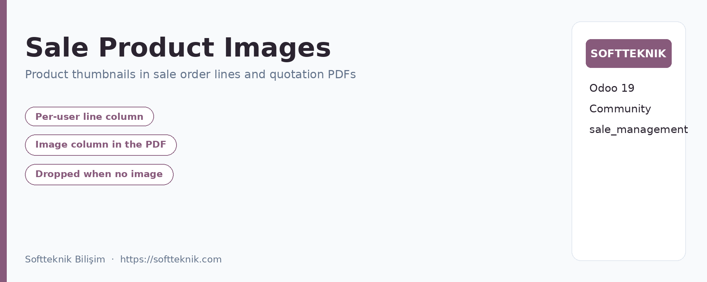

=============================================================================
Sale Product Images
=============================================================================

Overview
========
**Sale Product Images** shows product thumbnails directly inside sale order
lines and inside the printed customer quotation PDF report of Odoo 19.

Key Features
============
* **Visual Order Lines**: product thumbnails in the sale order line table, toggled
  per user from the list header (``optional="show"``).
* **Printed Quotation Reports**: product pictures in the customer PDF.
* **One Switch for the Report**: Sales > Configuration > Settings.
* **No Empty Column**: the PDF drops the image column when no line has an image.
* **PDF Safe Images**: re-encoded to JPEG on a white background before printing.
* **No Extra Dependencies**: needs ``sale_management`` only.
* **Turkish Translation**: ``tr.po`` included.

Supported Editions
==================
* Odoo 19.0 Community Edition

Technical Information
=====================
* **Dependencies**: ``sale_management``
* **License**: LGPL-3
* **Parameter**: ``sale_product_image.show_image_in_report``
* **Author**: Softteknik Bilişim
* **Support**: softteknik@softteknik.com
* **Website**: https://softteknik.com
